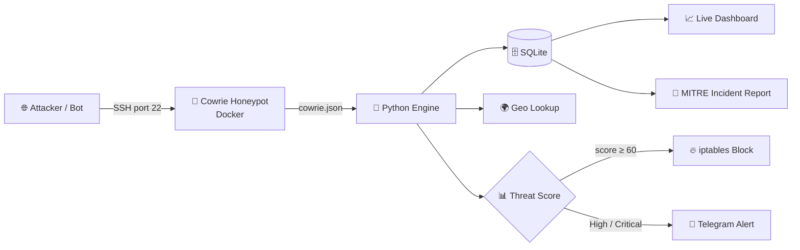

<div align="center">

# 🍯 Honeypot for Attack Detection

### Catch real attackers. Score them. Block them. Report them.

A live SSH honeypot on **AWS EC2** with a custom **Python security layer**: threat scoring, auto-blocking, Telegram alerts, a live dashboard and **MITRE ATT&CK** incident reports.


**YOUR NAME** · YOUR COLLEGE · Guide: GUIDE NAME

</div>

---

## 📸 Demo

<div align="center">


*Live dashboard: events, unique IPs, top attackers, countries, passwords and a real-time feed*

</div>

| 📱 Telegram alert | 📄 Incident report |
|---|---|
|  |  |

---

## 🎯 What it does

An attacker hits the fake SSH server, and the system handles the rest automatically:



**Real admin SSH runs on port 2200** (locked to my IP only), so the honeypot on port 22 can never reach the real server.

---

## ✨ Features

| | Feature | Details |
|---|---|---|
| 🔍 | **Detection** | Parses Cowrie JSON logs into SQLite (events + attackers) |
| 📊 | **Threat scoring** | Rule-based score per IP with Low / Medium / High / Critical severity |
| 🔥 | **Auto-block** | iptables `DOCKER-USER` chain, whitelist support, rules re-applied after reboot |
| 📱 | **Telegram alerts** | One alert on High/Critical, one on block (no spam) |
| 📈 | **Live dashboard** | Totals, events per hour, top attackers, countries, passwords, usernames, live feed |
| 🛡️ | **XSS-safe UI** | Attacker-controlled data is always HTML-escaped |
| 🧭 | **MITRE ATT&CK** | Observed behavior mapped to technique IDs |
| 📄 | **Incident reports** | Summary, timeline, IOCs, techniques, actions, recommendations |

---

## 🧮 Threat scoring

| Behavior | Points |
|---|---|
| Each failed login | +1 (max 30) |
| 10+ failed logins (brute force) | +25 bonus |
| Successful login | +20 |
| Each command (up to 10) | +3 |
| Suspicious command (`wget`, `curl`, `chmod`, `/etc/passwd`, `crontab`, `base64` ...) | +15 each |
| File download attempt | +40 each |

| Score | Severity | Action |
|---|---|---|
| 0 – 24 | 🟢 Low | Record only |
| 25 – 59 | 🟡 Medium | Highlight on dashboard |
| 60 – 99 | 🟠 High | Telegram alert + auto-block |
| 100+ | 🔴 Critical | Telegram alert + auto-block |

---

## 🧭 MITRE ATT&CK mapping

| Observed behavior | Technique | Name |
|---|---|---|
| Many failed logins | `T1110.001` | Brute Force: Password Guessing |
| Successful login | `T1078` | Valid Accounts |
| SSH session | `T1021.004` | Remote Services: SSH |
| Any shell command | `T1059.004` | Unix Shell |
| wget / curl / tftp / download | `T1105` | Ingress Tool Transfer |
| uname, lscpu, cpuinfo | `T1082` | System Information Discovery |
| whoami, id, w, who | `T1033` | System Owner/User Discovery |
| cat /etc/passwd | `T1087.001` | Account Discovery: Local Account |
| ls, find | `T1083` | File and Directory Discovery |
| ps, top | `T1057` | Process Discovery |
| ifconfig, ip a, netstat | `T1016` | System Network Configuration Discovery |
| crontab | `T1053.003` | Scheduled Task/Job: Cron |
| authorized_keys edit | `T1098.004` | SSH Authorized Keys |
| history -c | `T1070.003` | Clear Command History |
| xmrig, minerd | `T1496` | Resource Hijacking |

---

## 🧩 Ready-made vs built by me

| 📦 Ready-made (used as is) | 🛠️ Built by me |
|---|---|
| AWS EC2, Docker | Log parser / event collector |
| Cowrie honeypot | SQLite database design |
| Kali Linux + Hydra (demo attacker only) | Threat scoring rules + severity levels |
| ip-api.com (country lookup) | Auto-block engine (iptables) + whitelist |
| Telegram Bot API | Telegram alert logic |
| MITRE ATT&CK framework | Live dashboard (Flask + Chart.js) |
| | MITRE mapping + incident report generator |

---

## 🗂️ Project structure

```
├── config.py          settings (paths, whitelist, threshold, Telegram env)
├── db.py              SQLite connection and tables
├── geo.py             country lookup
├── scoring.py         score and severity rules
├── blocker.py         iptables block / unblock / reapply
├── notifier.py        Telegram alerts
├── mitre.py           event → ATT&CK technique mapping
├── report.py          incident report generator
├── main.py            engine: tail log → db → score → act
├── dashboard/         Flask app + templates/index.html
├── sample-reports/    example generated incident report
└── docs/              screenshots
```

---

## 🚀 Setup

<details>
<summary><b>1. EC2 and SSH port shift</b></summary>

- Launch Ubuntu t3.micro in Mumbai.
- Security Group: TCP 22 from anywhere (honeypot bait), TCP 2200 from **my IP only**.
- Move real SSH to port 2200 in `/etc/ssh/sshd_config`, restart ssh, and test in a second terminal before closing the first.
</details>

<details>
<summary><b>2. Cowrie honeypot (Docker)</b></summary>

```bash
sudo apt update && sudo apt install -y docker.io
sudo docker volume create cowrie-logs
sudo docker run -d --name cowrie --restart unless-stopped \
  -p 22:2222 \
  -v cowrie-logs:/cowrie/cowrie-git/var/log/cowrie \
  cowrie/cowrie:latest
```
</details>

<details>
<summary><b>3. Python environment and secrets</b></summary>

```bash
sudo apt install -y python3-venv python3-pip
python3 -m venv venv
./venv/bin/pip install flask requests
```

Create `.env` (never commit it) and run `chmod 600 .env`:

```
TG_TOKEN=your_bot_token
TG_CHAT=your_chat_id
```
</details>

<details>
<summary><b>4. Run the engine</b></summary>

```bash
set -a; source .env; set +a
sudo -E ./venv/bin/python main.py
```

For permanent use, run `main.py` and `dashboard/app.py` as systemd services.
</details>

<details>
<summary><b>5. Open the dashboard (SSH tunnel)</b></summary>

The dashboard listens on `127.0.0.1` only. From your laptop:

```bash
ssh -p 2200 -i your-key.pem -L 5000:127.0.0.1:5000 ubuntu@SERVER_IP
```

Then open **http://localhost:5000**
</details>

<details>
<summary><b>6. Generate an incident report</b></summary>

```bash
./venv/bin/python report.py ATTACKER_IP
```
</details>

---

## 📝 Results and honest note

The server received real internet scanners from many unique IPs. No real bot completed a login during the observation period. Brute force, successful login, commands, downloads, auto-block and the incident report were demonstrated with a **controlled attack from my own Kali VM (Hydra) against my own honeypot**. The report in `sample-reports/` uses a documentation placeholder IP.

---

## ⚠️ Limitations and future work

- Scoring is per IP, so distributed botnets are not correlated. *Future: ASN/subnet and credential-pattern correlation.*
- Services run as root for simplicity. *Production: least privilege, sudoers for iptables only.*
- Default Cowrie can be fingerprinted. *Future: customize hostname and filesystem.*
- *Future: SIEM integration (ELK/Wazuh), AbuseIPDB reputation, ML anomaly scoring, multiple honeypots.*

---

## 🔐 Ethics and safety

Only traffic hitting my own server is recorded. The server holds no real data. Attacks were tested only against my own honeypot. Secrets (`.env`, `.pem`, database) are excluded via `.gitignore`.

<div align="center">

*Built as a final-year project · Honeypot for Attack Detection*

</div>
